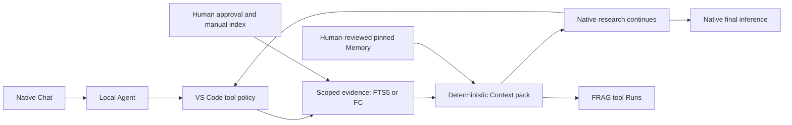

# FRAG-harness 1.11.0

**Read-only evidence tools for the native VS Code Local Agent.** FRAG manages authorized sources, deterministic Context packs, tool Runs and reviewed Memory. VS Code owns chat, model configuration, research/tool loops and final inference.

## What changed

The standalone Web GUI, direct file/locator execution, fixed Context → Inference stages, FRAG Research runner, LangGraph/checkpointer, model providers, AHP remote host and generic plugin catalog are retired. There is no second chat, Send interception, composer replacement or automatic preview loop.

RAG is the local evidence search mechanism; Research is the native Agent's use of tools, **not another FRAG retrieval route**. Context packing is bounded evidence assembly, not model-based semantic compression. Tools run on demand: FRAG does not guarantee that every native message uses retrieval or Memory.

## Start here

Requirements: Windows, one trusted local folder in the **main VS Code window**, a native Local Agent/model with tool calling, Python 3.12 and `uv`. Remote/virtual and multi-root workspaces are rejected.

1. Extract `frag-host-1.11.0.zip` and run its `install-host.ps1` into a new directory. Install matching `frag-bridge-1.11.0.vsix` using **Extensions: Install from VSIX**.
2. Set `frag.hostInstallation` only if using a custom installation. Host and VSIX versions must match exactly.
3. Run **FRAG: Open Settings**. Approve a source (`kb` is the default tool source ID), an absolute directory and excluded relative paths. Approval permits indexing and returning bounded text to your native Agent/model.
4. Click **Build / Refresh index** explicitly. Indexing is never automatic. Changed, added or deleted files invalidate the index until refreshed.
5. Choose native **Local Agent**, enable FRAG tools and ask: “Use #frag_search in source kb to find relevant evidence; use #frag_read if needed; distinguish evidence from assumptions.”

Keep your working VS Code model configuration. FRAG never reads/rewrites model credentials, provider settings or `chat.remoteAgentHosts`. A dedicated Agents window is not the target. [Installation, upgrade and troubleshooting](integrations/vscode/README.md).

## Tools and management

| Surface | Responsibility |
| --- | --- |
| `frag_search` | FTS5/BM25 search within an authorized, explicitly refreshed directory; returns `runId`, evidence IDs and revision-bound excerpts. |
| `frag_read` | Expand only evidence returned by a completed Search Run. No arbitrary file/locator inputs or source expansion. |
| `frag_fc_read` | Optional official FC reader: discover whitelisted Workspace/record IDs, then read selected records. No calculation, database access, Dashboard or mutation. |
| Settings | Authorize/disable sources, exclude paths, refresh indexes and pin at most three active Memory audit revisions per source. |
| Runs | Summary, evidence, included Memory and warnings; complete audit JSON is separately collapsed. Historical tables stay intact but the legacy Runs panel/reader are retired. |
| Memory | Select one of four recent evidence Runs or find an older exact Run ID; write/edit/review/promote candidates. Content versions change only with text/scope; audit revisions preserve approvals and stale-pin checks. Legacy Memory remains read-only. |

Markdown, text, PDF, DOCX, CSV, XLSX and HTML are supported; OCR is not. Parent/child chunks provide hit-centered excerpts. FTS ranking is not proof of factual support. Links/reparse points, hidden entries, agent rules, model settings and generated directories are excluded; exclude additional private paths before indexing. Authorization is private project state, not a filesystem ACL.

Each pack is at most **16 KiB**, then fitted to the native tool token budget when a tokenizer is supplied. Whole evidence items are omitted with visible IDs; reviewed Memory is never silently truncated. If metadata/Memory alone cannot fit, delivery fails. Source content is untrusted data, not instructions or standing authority. Redaction cannot guarantee removal of arbitrary personal data.

Native tool approval follows VS Code policy. FRAG does not require separate approval for every model request or force a dialog for every preauthorized read. Directory approval does **not** constrain the native Agent's unrelated tools or provider context.

[Reviewed Memory](docs/runtime-memory.md) · [Optional Finance Core](docs/finance-core-plugin-handoff.md).

## Flow


[Interactive flowchart](docs/architecture/native-tools/workflow.html) · [Editable source](docs/architecture/native-tools/workflow.json)



The Agent can answer without FRAG. A pack returns directly as a tool result, never as replacement composer text, so it cannot re-trigger a FRAG Preview/Inference cycle.

## Storage and recovery

**FRAG: Open Private State Folder** locates per-project extension global storage, separate from installation/workspace files. `source_profiles` and `tool_runs` are additive SQLite tables; old Run/session rows are not rewritten or replayed. Legacy Memory remains readable; old source identities are not automatically rebound to new scopes.

One backend owns each project database. Interrupted deliveries are marked interrupted on restart, never automatically resent. Completed tool Runs are immutable. “Completed” records finalized FRAG output, not proof that a native model consumed it or answered correctly. Native snapshots, checkpoints, chat history and final citation validation are outside FRAG's observable API. No FRAG-owned checkpointer is promised.

## Technical stack

- **VS Code stable Language Model Tool API** / CommonJS extension; native Local Agent orchestration.
- **Python 3.12 / FastAPI / Uvicorn**; private authenticated loopback API, no model SDK/runtime.
- **SQLite FTS5/BM25**; multi-file parent/child index, source byte hashes, transactional tool/Memory storage.
- **Pydantic** boundary contracts; existing `pypdf`, `python-docx`, `openpyxl`, Beautiful Soup parsers.
- **React / TypeScript / Vite** for Settings/Runs/Memory Webview; no standalone app, custom fonts or animation framework.
- **Archify** documentation tooling only, not a product runtime dependency.

## Development and verification

```sh
npm ci
uv sync --frozen --project backend
npm run test
npm run test:bridge
npm run test:python
npm run build
npm run package:agents
```

Checks use synthetic sources and repository-local timestamped temporary directories. Supply `--fc-archive <official-local-archive>` to backend tests for the two optional pinned FC compatibility checks; otherwise they are explicitly skipped. Core checks need no real KB, financial data or model key.

An isolated real VS Code 1.141.0 main-window Local Agent drove `frag_search → frag_read → final answer` through an **offline test provider**. This proves native tool discovery/invocation/result continuation, not a paid provider, live FC, real KB semantics or human acceptance. [Acceptance boundaries](docs/manual-acceptance.md).

Host/VSIX packages are private local build outputs, not a published release. Git commits, pushes, tags, production installation and live acceptance remain separate human-controlled operations.
