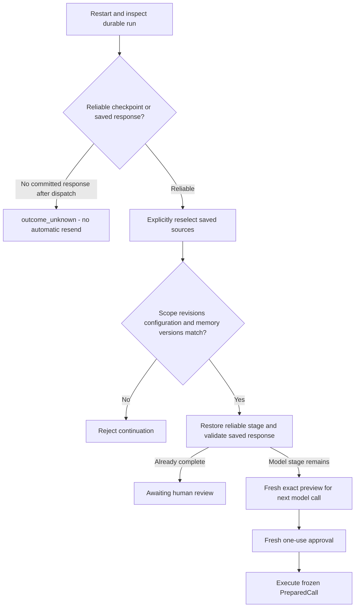
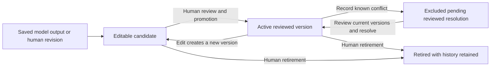
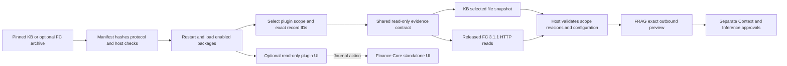
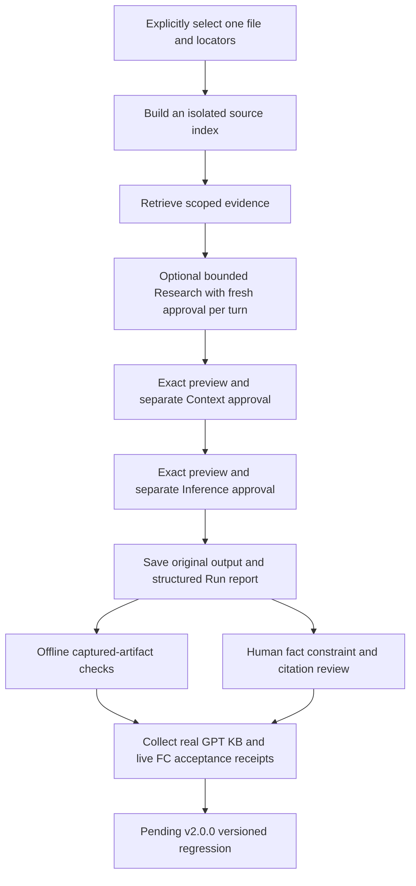

# FRAG-harness v1.9.0

The optional [Pi Responses adapter](docs/pi-adapter.md) uses a pinned, reviewed backend-only module selection. Enable it separately for Research, Context and Inference; every request retains exact preview and one-use approval. The maintainer reports real-model and manual integration verification complete for the existing FRAG functionality; those results are separate from the VS Code carrier check below.

FRAG-harness is a local application for governed evidence retrieval, an optional bounded Research loop and two formal model stages. It starts with no Finance Core installation, account, token, or database. Research collects selected evidence through real read tools; the Context LLM compresses approved evidence and the Inference LLM produces a cited answer. Selection, redaction, token budgeting, approval, output validation, and citation checks are deterministic host code.

## VS Code migration: Plan D

Plan D targets a FRAG session in the VS Code Agents window and a FRAG-designed right-hand review page. The existing standalone GUI is retained. The offline [VS Code compatibility probe](integrations/vscode/README.md) registered successfully on VS Code 1.140.0, but FRAG did not appear in the native session picker and the session-opening command failed with a renderer `loadSession` error. The FRAG content provider and handler were never invoked. Native migration and the right-hand review page remain unimplemented pending a carrier decision.

[Explore the migration boundary](docs/architecture/vscode-migration/architecture.html) · [Editable source](docs/architecture/vscode-migration/architecture.json).


## What runs in the core

The React interface offers Harness, RAG Lab, Runs, Memory, and Plugins. The FastAPI backend owns local source parsing, exact outbound previews, single-use approval tokens for each model stage, the two model routes, citation validation, durable run history and human review, and rebuildable SQLite FTS5 indexes. RAG Lab can use the bundled synthetic dataset or one explicitly selected local file and its selected locators. Fake model providers work offline. Real model API credentials live only in `backend/.env`.

Both stages execute the server-owned `PreparedCall` that was previewed. It binds the complete request JSON, destination, transport, model, output schema, timeout, source revisions, selected locators, checklist and host policy versions. Revalidation rejects changed bindings; execution does not rebuild a request from evidence. Source hashing and parsing use one byte snapshot, and RAG hits, parent text and index revision share a database read snapshot. Input estimates include instructions and schemas; each stage and the cumulative run have budget checks.

The host exposes executable CLI, tool and loop registrations through `GET /api/harness/capabilities`. The fixed runner remains available; optional Research proposes selected read calls, executes them through host policy, and returns observations to a later separately approved model turn. `frag.host` operates the same running FastAPI host over loopback HTTP; `kb.search` searches explicitly selected evidence and `kb.read` starts a fixed CLI process to read the selected redacted snapshot. Tools cannot expand file, locator, revision or Workspace scope. Reviewed memory is available through the [human memory workflow](docs/runtime-memory.md); only explicitly confirmed, active versions enter a fresh request. Blocking checklist items require a reviewed `met` status before approval is available. See [Research loop](docs/research-loop.md), [runtime contracts](docs/runtime-contracts.md), [host CLI](docs/host-cli.md) and [KB tools](docs/kb-tools.md).

Runs stores explicitly selected, redacted snapshots and request specifications in an independent, Git-ignored `.local-runtime/runtime.sqlite3`. Use the session picker to group work. Editing input creates a linked new run; editing output creates a separate human revision while retaining the model original. The Runs page records acceptance, rejection and pause, and exports the same structured report as JSON or Markdown. A new revision requires its own review.

Recovery requires explicit reselection matching the saved sources, scope, revisions and request configuration, then a fresh preview and approval. A validated Context checkpoint resumes at Inference. A durably saved response can finish deterministic validation after restart. An interrupted dispatch without a committed response becomes `outcome_unknown` and cannot resume in the same run. It is never resent automatically. See [sessions and recovery](docs/runtime-sessions.md) for state, privacy and endpoint details.

Offline evaluation uses versioned synthetic Gold and the production retrieval, model-stage validators, selected-read policy and tool carriers. Research cases record actual approved turns, serial tool execution, result feedback and finish decisions. A separate capture mode scores an explicitly exported Run report against source-bound, human-written Gold without regenerating model outputs or rereading sources. Evaluation separates host enforcement, scripted or captured model artifacts, trajectory checks, missing checks and scorer failures. Literal fact and trajectory checks do not establish semantic support; human review remains undetermined. See [offline evaluation](docs/offline-evaluation.md).

Memory candidates come from a saved model output or human revision. Editing, reviewing and promoting are human operations; FTS5 recommends at most three records after scope, status and conflict filtering. The next request binds their exact versions as background, while citations remain restricted to current evidence. Changing memory invalidates old previews. See [runtime memory](docs/runtime-memory.md).

## Architecture review diagrams

The seven core light-only SVG exports below describe the fixed Harness, RAG Lab, optional Research, reviewed-memory and plugin paths; the migration section adds a separate compatibility diagram. Each Archify diagram has a linked light-only interactive HTML view and an editable Archify JSON specification under `docs/architecture/`. They are review documentation, not runtime telemetry or orchestration. Reviewed memory follows the same exact preview, version revalidation and one-use approval gates.

### Harness

The Harness path assembles explicitly selected local excerpts or bounded plugin records. KB and Finance Core readers share the host's scope, redaction, exact preview, approval and validation gates around the two model APIs. [Explore the Harness data flow](docs/architecture/harness/dataflow.html).


Each stage requires a separate exact-input preview and a single-use approval. The host re-reads evidence and checks source bindings and confirmed memory versions before a call; invalid approval stops that stage. [Explore the Harness approval lifecycle](docs/architecture/harness/lifecycle.html).


### RAG Lab

RAG Lab has a Build path and a query path. Choose the bundled synthetic Markdown dataset or explicitly select one local file and up to twenty locators, then click Build. The host recursively splits the selected sections into overlapping small chunks and stores child-to-parent relationships in an isolated SQLite FTS5 cache. Unselected sections cannot enter expanded parent context. Local caches are separated by source root, file and locator scope. A source change makes the cache stale; explicitly rebuild caches after parser or index-strategy upgrades. A query ranks small chunks by retrieval `chunkId`; Preview deduplicates their parent sections and shows bounded parent context with a marked hit window and a distinct Context `evidenceId`. Search and Preview make no model call. [Explore the RAG index and retrieval flow](docs/architecture/rag-lab/dataflow.html).


After retrieval, the optional answer path needs a ready index and retrieved evidence before Context Run. Context and Inference each require an exact input preview and independent one-time approval. The host checks compressed Context `evidenceId` values after the Context call and answer `evidenceIds` citations after the Inference call, before human review. [Explore the RAG query and approval lifecycle](docs/architecture/rag-lab/lifecycle.html).


Preview never calls a model. The first Run executes only the Context stage and returns validated compression plus the exact Inference instructions and input JSON for a second approval. Inference Run executes the second stage after approval. Tokens expire after ten minutes, are consumed once, and bind the displayed input to its source or index revision. Changed inputs and reused tokens are rejected. Provider credentials stay in the backend.

### Research and recovery

Research gathers evidence before Context and Inference. A model proposes complete calls; the host validates scope and budgets, runs the registered read tools, and persists their observations. Continuing requires a new exact preview and approval. Finishing selects observed evidence for the two separately approved answer stages. [Explore the Research workflow](docs/architecture/research/workflow.html) · [Editable source](docs/architecture/research/workflow.json).


The following recovery flow summarizes the reliable-checkpoint path. Source, configuration or selected memory version changes reject continuation. Unknown dispatch outcomes cannot be resent in the same run. A saved response may complete deterministic validation after restart; validation is not human acceptance.



### Reviewed memory

A saved Run supplies a candidate, not reusable authority. Human editing, review and promotion produce an active version. Scope and conflict filtering precede FTS5 recommendations; you confirm at most three exact versions before a fresh preview. The host revalidates them before each Research, Context or Inference dispatch. Memory stays separate from current evidence, the rebuildable RAG index and shared Mei storage. [Explore the memory workflow](docs/architecture/memory/workflow.html) · [Editable source](docs/architecture/memory/workflow.json) · [Runtime memory details](docs/runtime-memory.md).


The lifecycle below summarizes human-controlled version changes. Retired and known-conflict records are excluded from normal recommendations; editing an active record requires review again. Historical outputs retain the versions they used.



## Start locally

Requires Node.js, npm, Python 3.12, and `uv`. From the repository root:

```powershell
npm install
uv sync --project backend --cache-dir .tmp/uv-cache
npm run dev
```

Open `http://localhost:5173`; the backend listens on `http://127.0.0.1:8787`. To configure either model, copy `backend/.env.example` to the Git ignored `backend/.env` and set provider, model, and backend-only credentials. `fake` is the default for both stages. Put supported `.md`, `.txt`, `.html`, `.pdf`, `.docx`, `.csv`, or `.xlsx` files under `local-sources/`; the folder is ignored except for instructions and placeholders. Files are never automatically indexed by the product.

The bundled RAG Lab source is `shared/demo/rag/synthetic-risk-review.md`. Selected-local mode uses the configured local source root and explicit file/locator selection. Its caches live under `.local-index/selected/`, separately from the synthetic index and durable Run/memory database. English words and Chinese bigrams are indexed as keyword terms; there is no embedding or vector retrieval. No personal KB material is bundled or automatically indexed. The synthetic Gold button evaluates the bundled dataset; actual exported Run artifacts use the offline capture runner.

Local caches, browser review profiles, and disposable test evidence under `.tmp/` have different retention rules. See the [temporary workspace guide](docs/tmp-workspace.md) before moving or cleaning them.

## Read-only plugins

The Plugins page accepts a trusted three-file ZIP and its published SHA-256, shows each package independently, and provides per-plugin Enable, Disable and removal instructions. Restart after installation or activation changes. A disabled, invalid or changed package exposes no reader, plugin routes or UI; other valid plugins remain usable. Plugin code executes in the backend, so only install a trusted artifact.

Protocol 2 supplies the same selected-read interface for KB and Finance Core. The host validates the plugin, scope and exact record IDs, checks bounded results, and binds source revisions, non-sensitive source configuration and package hashes before each approved model stage. Protocol 1 Finance Core packages remain supported. [Plugin protocol and manual removal](docs/plugin-protocol.md) · [Explore the plugin workflow](docs/architecture/plugins/workflow.html) · [Editable source](docs/architecture/plugins/workflow.json).


KB plugin v1.0.0 is built from original source in `plugins/kb/` and available as [a pinned local archive](docs/release/kb-frag-plugin-v1.0.0.zip). It reuses the existing snapshot parser. Select KB in Harness, choose a file and up to ten locators, then review Context and Inference separately. It defaults to `local-sources/`; an optional backend `FRAG_KB_SOURCE_ROOT` explicitly selects another root. Listing candidates does not index files or parse unselected documents. Plugin evidence uses the fixed workflow; Research keeps its existing selected-local-file path.

```powershell
python scripts/build-kb-plugin.py
powershell -NoProfile -ExecutionPolicy Bypass -File ./scripts/install-plugin.ps1 -ArchivePath './docs/release/kb-frag-plugin-v1.0.0.zip' -ExpectedSha256 '9c64d6a221c799b41e33906773c0174d688a629325d7096baeceaa72512e4b4f' -PluginId kb
# Restart FRAG, then choose KB in Harness.
```

Finance Core remains optional and independently runnable. Its authoritative plugin source and release archive stay in FC. FC plugin v1.1.0 targets protocol 2 and FRAG >=1.8.0, while the original v1.0.0/protocol 1 archive remains compatible. Both use Released FC API 3.1.1; FC product 3.2.0 is independent from these versions. Obtain the separately verified archive and SHA-256 from FC, install it through Plugins, then configure its backend-only read token and explicit Workspace/record allowlist. [FC handoff and compatibility](docs/finance-core-plugin-handoff.md).

FC reads only configured, explicitly selected Workspace records through bounded HTTP GETs. FRAG never opens FC SQLite or calculates finance values. Journal and other mutations open FC's standalone UI. Synthetic contract and host integration tests verify the adapter; live FC and real financial data acceptance remain pending. Historical memories remain visible. Both plugin protocols bind current memory scope to source configuration; old unqualified memories require a new source-bound candidate and human review/promotion.



Disabling a package preserves its files and immediately hides its reader, routes and UI. Automatic batch uninstall is blocked. To remove files, disable the package, stop FRAG, inspect its exact directory under `.local-plugins/`, and delete that directory manually in File Explorer. No cleanup is required for this phase's ignored synthetic test artifacts.

## Checks and boundaries

The engineering version remains v1.9.0. The maintainer reports real-model and manual integration verification complete for existing FRAG functionality. This migration task did not repeat those checks or assess live FC. Private acceptance receipts, explicit phase acceptance and final versioned regression remain separate from a version change; this task does not close Phase 8 or release v2.0.0. Follow the [manual acceptance guide](docs/manual-acceptance.md) and keep actual reports and Gold in ignored local storage. The [frontend constraints](docs/frontend-iteration.md) record the behavior retained by the standalone GUI and a future review surface.



```powershell
npm test
npm run typecheck
npm run build
$runId = [guid]::NewGuid().ToString('N')
$env:PYTEST_ADDOPTS="--basetemp=.tmp/pytest-frag-$runId -p no:cacheprovider"
npm run test:python
```

Tests use synthetic sources and temporary indexes. Backend-only keys and optional FC tokens must never enter browser assets, prompts, logs, tracked files, or error responses. Model answers require human review. FRAG does not connect to trading, banking, payment, or live-market APIs. The [plugin handoff](docs/finance-core-plugin-handoff.md) defines the optional FC integration boundary.

LangGraph runs embedded in FastAPI for Research turn/tool routing, Context Run, and Inference Run orchestration. Preview is an ordinary host function and makes no model call. Host code still owns evidence selection, budgets, approval tokens, provider calls, validation and durable checkpoints. The graphs have no LangGraph checkpointer, external Agent Server, or LangSmith tracing. Research supports complete typed model proposals and optional native Pi tool-call transport. [Future Agent Server assessment](docs/horizon/horizon-1.md). Archify is an optional project-local Codex skill under the Git-ignored `.agents/skills/archify` directory for development review, not an application dependency.

Thanks to [Archify](https://github.com/tt-a1i/archify) for the diagram tooling. The Archify 2.17 viewers are distributed with their [MIT copyright and permission notice](docs/architecture/ARCHIFY-LICENSE.txt); retain this notice when sharing the viewers separately.
