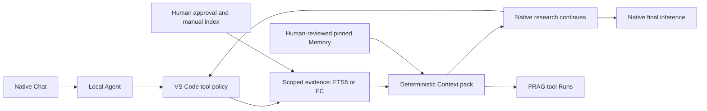

# FRAG-harness 1.13.4

Read-only evidence tools inside the **main VS Code window**. VS Code owns chat and models; FRAG supplies authorized evidence, Runs and reviewed Memory.

[First install](#first-install) · [Update](#upgrade-an-existing-installation) · [Daily use](#daily-startup-and-shutdown) · [Troubleshooting](#troubleshooting)

## Start here

- **Required:** Windows, VS Code **1.140+**, PowerShell **7** (`pwsh`), `uv`, Python **3.12**, and a model that supports tools.
- Use your usual VS Code **instance/profile** and **one trusted local folder**. No dedicated Agents window, remote folder or multi-root workspace.

**Install once. Update when the version changes. Daily use needs neither step.**

## First install

### 1. Get the two matching files

Local checkouts and GitHub use the same folder: [`packages/v1.13.4/`](packages/v1.13.4/).

| File | Download / local filename |
| --- | --- |
| Host | [frag-host-1.13.4.zip](packages/v1.13.4/frag-host-1.13.4.zip) |
| VS Code extension | [frag-bridge-1.13.4.vsix](packages/v1.13.4/frag-bridge-1.13.4.vsix) |
| SHA-256 checksums | [receipt-1.13.4.json](packages/v1.13.4/receipt-1.13.4.json) |

**On GitHub:** open the Host and VSIX links and download the files. **Locally:** copy them from the folder above, relative to the repository root (contains this `README.md` and `package.json`). Missing files? [Build packages](#development-and-verification).

Put both files in `%USERPROFILE%\Downloads`. Paste that path into File Explorer's address bar and press `Enter` to open the exact folder used below.

### 2. Install the Host in PowerShell 7

Open **PowerShell 7** from the Windows Start menu. Run from **any directory**:

```powershell
$ErrorActionPreference = 'Stop'
$Zip = Join-Path $env:USERPROFILE 'Downloads\frag-host-1.13.4.zip'
$Bundle = Join-Path $env:USERPROFILE 'Downloads\frag-host-1.13.4'
if (!(Test-Path -LiteralPath $Zip -PathType Leaf)) { throw 'Download the Host ZIP to the exact Downloads folder above first.' }
Expand-Archive -LiteralPath $Zip -DestinationPath $Bundle
Set-Location $Bundle
pwsh -NoProfile -File .\install-host.ps1
```

`$env:USERPROFILE` and `$env:LOCALAPPDATA` resolve automatically; do not replace them.

Use the **extracted bundle's** installer, not the source file `integrations\vscode\install-host.ps1`. It initializes locked dependencies through `uv`; no npm step is needed for installation.

| Location | Purpose |
| --- | --- |
| `%USERPROFILE%\Downloads\frag-host-1.13.4` | Extracted bundle; contains the installer |
| `%LOCALAPPDATA%\FRAG\host\1.13.4` | Installed Host; created by the installer |
| Your chosen project folder | Native Chat workspace; separate and unlinked from both locations above |

The installer **refuses an existing target**. Skip it only if that exact Host version was installed successfully; otherwise retain the folder for inspection. Never delete project state to retry. If the extraction folder already exists, change `$Bundle` to a new folder.

### 3. Install the VSIX in VS Code

1. In your usual **main VS Code window**, press `Ctrl+K`, then `Ctrl+O` to open your project folder.
2. Press `Ctrl+Shift+P`, run `Extensions: Install from VSIX`, and select `frag-bridge-1.13.4.vsix` from the exact Downloads folder in step 1.
3. Press `Ctrl+,`, search `@id:frag.hostInstallation`, and **leave its value empty** to use the default Host above. Clear an explicit old path; it overrides the new default. Do not enter the literal `%LOCALAPPDATA%` here.
4. Press `Ctrl+Shift+P` and run `Developer: Reload Window` **in this same project window**.

Need the resolved installation path? Run this in PowerShell:

```powershell
Join-Path $env:LOCALAPPDATA 'FRAG\host\1.13.4'
```

### 4. Check the native model — in VS Code Chat

Select **Local → Agent → your actual model**. Keep a working provider/key unchanged; FRAG does not configure them.

For a new provider: `Ctrl+Shift+P` → `Chat: Manage Language Models`; enter keys only in the native secure prompt.

Before authorizing private files, disable FRAG tools and test **two short messages in the same chat**. Then test tools below. A greeting alone does not prove tool support.

Provider errors or token limits: [native model setup and troubleshooting](integrations/vscode/README.md#native-model-configuration-and-errors).

### 5. Authorize one source — in FRAG Settings

Press `Ctrl+Shift+P` → `FRAG: Open Settings`.

| Field/action | What to enter or do |
| --- | --- |
| Source ID | Keep `kb` for the first test. |
| Approved directory | Create a nonsecret test folder with `check.md` containing `FRAG smokecheck: blue.`. Copy the folder's **full path** from File Explorer's address bar. |
| Excluded relative paths | Files/subfolders that must not be indexed. |
| Approval checkbox | Review the directory, exclusions and any Memory selection. |
| `Save authorization` | Creates the saved source; a form showing `kb` alone does not. |
| `Build / Refresh index` | Click explicitly. Indexing is never automatic. |

**Approval permits source text to be returned to your native Agent/model.** It does not restrict the Agent's other tools. No credentials/private material in the first test.

### 6. Make one tool call — in native Chat

1. Open **Configure Tools** in Chat. Enable `frag_search` and `frag_read`; leave `frag_fc_read` off for now.
2. With the test file above, ask:

   > Use #frag_search with sourceId "kb" and query "smokecheck", then #frag_read on a returned result. What colour does the evidence state?

3. `Ctrl+Shift+P` → `FRAG: Open Runs`. Inspect the new Run, evidence and warnings; the test file states **blue**. Judge the model's answer separately.

## Connect Finance Core — optional

The Host already includes **official reader 1.10.0**. It prepares the reader for each project on first start; **no separate reader installation**. FC must run **API 3.10.0** independently.

| Where | Action |
| --- | --- |
| FC → **Settings → Connect FRAG** | Choose one Vault and its maximum readable range: **All / Living / Investment / Specific accounts or data items**. Create the connection, then **Copy FRAG configuration**. |
| VS Code → `Ctrl+Shift+P` | Run `FRAG: Connect Finance Core`. The correct private **`fc.env`** opens in **Notepad**. Paste with `Ctrl+A`, `Ctrl+V`, then `Ctrl+S`. Do not create or locate a file yourself. |
| FRAG Settings → **Finance Core** | Click **Check connection**. Verify the Vault name/kind and FC permission ceiling. Select the smaller FRAG subset; report choices reveal date/month fields. Approve and **Save authorization**. No index build. |

**The copied configuration contains a secret. Never paste it into chat, a Webview, Git or screenshots.** Checking shows identity, permissions and item names only; it does not read reports. Up to ten explicitly selected records are available to FRAG. New FC items never automatically enter FRAG's subset.

For the first factual financial check, [list first, then explicitly read one selected report](docs/finance-core-plugin-handoff.md#first-real-vault-run). A partial month uses **Month to date** with an exact cutoff. A tool Run is not human acceptance or financial advice.


## Upgrade an existing installation

Keep the **same project, VS Code instance and profile** to retain private state.

1. `Ctrl+Shift+P` → `FRAG: Open Private State Folder`. Back up if needed; keep it outside Git.
2. `Ctrl+Shift+P` → `FRAG: Stop Evidence Backend` in that same window.
3. Obtain the new **matching Host ZIP and VSIX**. Follow [Host installation](#2-install-the-host-in-powershell-7) and [VSIX installation](#3-install-the-vsix-in-vs-code). Do not overwrite or delete the old Host.
4. Clear an explicit old `frag.hostInstallation`, then run `Developer: Reload Window` in the same project window. Do not recreate working model credentials.
5. Check ordinary chat, then Search/Read. Refresh stale indexes and reconfirm stale Memory pins; do not rebuild unchanged sources.

The matching official reader is bundled and prepared automatically; an explicitly disabled reader stays disabled. Keep FC on the required API version. Existing legacy tokens are not broadened: use **FC Settings → Connect FRAG** for the new scoped setup.

Upgrading from **1.10.x**? Use the separate [legacy migration](integrations/vscode/README.md#upgrade-from-110x); do not restart the retired Remote Host.

## Daily startup and shutdown

| Action | Where / command |
| --- | --- |
| Open your project | Main VS Code window: `Ctrl+K`, then `Ctrl+O`. Keep the usual profile/model. |
| Open FRAG | `Ctrl+Shift+P` → `FRAG: Open Settings`. The first FRAG tool can also start the backend. |
| Refresh changed sources | FRAG Settings → `Build / Refresh index`. Unchanged sources need no daily rebuild. |
| Inspect evidence | `Ctrl+Shift+P` → `FRAG: Open Runs`. |
| Review Memory | `Ctrl+Shift+P` → `FRAG: Open Memory`. Review/promote manually; repin changed versions in Settings. |
| Stop FRAG | `Ctrl+Shift+P` → `FRAG: Stop Evidence Backend`, or close its owning window. |

No daily installation or key re-entry. Chat can answer without FRAG; an unchanged Runs count alone is not an error. One backend per private project state.

## Troubleshooting

| Symptom | Next action |
| --- | --- |
| `pwsh` is not recognized | Make PowerShell 7 available before continuing; do not substitute PowerShell 5.1. |
| Host installation refuses the target | Inspect `%LOCALAPPDATA%\FRAG\host\1.13.4`. Reuse a successful exact-version install; do not blindly delete it. |
| FRAG commands/tools are missing | Check the matching VSIX, trusted single local folder, Local Agent mode and Configure Tools. |
| `NOT_FOUND` / `INDEX_NOT_BUILT` | Save source `kb` in FRAG Settings, then build its index. Use the saved ID if you chose another name. |
| `INDEX_STALE_REFRESH_REQUIRED` | Review changed files, then refresh the source index manually. |
| Native chat fails, or tool budget metadata is invalid | Diagnose the native model first; do not reinstall/reindex or bypass budget validation. |

[Detailed model, budget and FC troubleshooting](integrations/vscode/README.md#daily-use-and-troubleshooting).

## Boundaries and further reading

- A completed Run records finalized tool output, **not** model consumption or answer correctness. Required reports/plans and selected Memory stay whole or delivery fails.
- Production financial/life recommendations remain unavailable. The synthetic safety gate does **not** filter ordinary native chat.
- FC owns financial calculations, storage and writes; FRAG's optional official reader is GET-only.
- Private state belongs outside the source checkout. Locate it with `FRAG: Open Private State Folder`; never commit keys, databases, real evidence or backups.

[Confirmed plans](docs/confirmed-plan-evidence.md) · [Memory](docs/runtime-memory.md) · [Safety](docs/recommendation-safety.md) · [Acceptance limits](docs/manual-acceptance.md)

## Flow

<details>
<summary>Architecture diagram</summary>


[Interactive flowchart](docs/architecture/native-tools/workflow.html) · [Editable source](docs/architecture/native-tools/workflow.json)



</details>

## Development and verification

<details>
<summary>Build packages — only if the files are missing or you are developing FRAG</summary>

**Where:** File Explorer → repository root (contains `README.md` and `package.json`) → type `pwsh` in the address bar → `Enter`. Run the commands in that PowerShell 7 window. Building also requires Node.js/npm.

```powershell
npm ci --cache .tmp/npm-cache
uv sync --frozen --project backend --cache-dir .tmp/uv-cache
npm run test
npm run test:bridge
npm run test:python
$Reader = Read-Host 'Full path to the official finance-core-frag-plugin-v1.10.0.zip'
npm run package:agents -- --fc-archive "$Reader"
```

**Output:** [`packages/v1.13.4/`](packages/v1.13.4/) — matching Host ZIP, VSIX and SHA-256 receipt. Return to [First install](#first-install); building does not install anything into VS Code.

Tests use synthetic sources, not real data or model keys. Offline checks, native-model continuation and human acceptance are separate. Publication and production installation remain manual.

</details>
