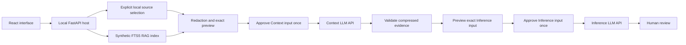
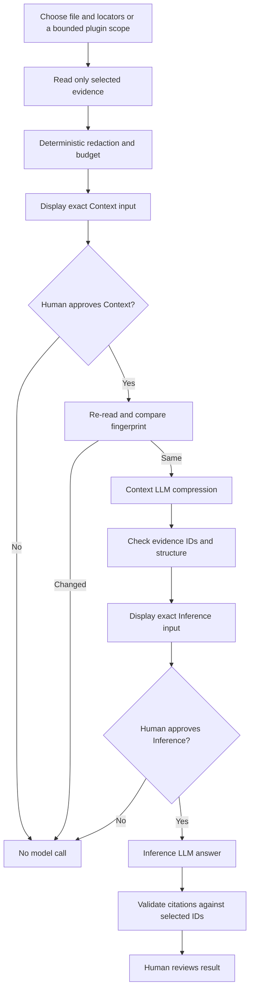
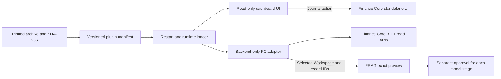

# FRAG-harness v1.0.0

FRAG-harness is a local application for governed evidence retrieval and two model API stages. It starts with no Finance Core installation, account, token, or database. The Context LLM compresses approved evidence; the Inference LLM produces a cited answer. Selection, redaction, token budgeting, approval, output validation, and citation checks are deterministic host code.

## What runs in the core

The React interface offers Harness, RAG Lab, and Plugins. The FastAPI backend owns local source parsing, exact outbound previews, single-use approval tokens for each model stage, the two model routes, citation validation, and a rebuildable SQLite FTS5 index for a bundled synthetic RAG dataset. Fake model providers work offline. Real model API credentials live only in `backend/.env`.



Search and preview do not call a model. The first `/run` call executes only the Context stage and returns its validated compression plus the exact Inference instructions and input JSON for a second approval. `/inference/run` executes the Inference stage after that approval. Each approval is single-use, expires after ten minutes, and is bound to the displayed input and source revision. Source changes, changed selection, and reused tokens are rejected. The browser sees provider status but no model credentials.



## Start locally

Requires Node.js, npm, Python 3.12, and `uv`. From the repository root:

```powershell
npm install
uv sync --project backend --cache-dir .tmp/uv-cache
npm run dev
```

Open `http://localhost:5173`; the backend listens on `http://127.0.0.1:8787`. To configure either model, copy `backend/.env.example` to the Git ignored `backend/.env` and set provider, model, and backend-only credentials. `fake` is the default for both stages. Put supported `.md`, `.txt`, `.html`, `.pdf`, `.docx`, `.csv`, or `.xlsx` files under `local-sources/`; the folder is ignored except for instructions and placeholders. Files are never automatically indexed by the product.

The RAG Lab indexes only `shared/demo/rag/synthetic-risk-review.md` after an explicit Build action. It uses section chunks and SQLite FTS5. Source changes make the index stale until an explicit rebuild. It has no embedding or vector retrieval in v1.0.0.

## Optional Finance Core plugin

The core has no Finance Core routes or navigation while the plugin is absent or disabled. A trusted plugin archive contains exactly `manifest.json`, `adapter.py`, and `ui.js`. Its manifest declares `id: finance-core`, `protocolVersion: 1`, its semantic version, `minHostVersion: 1.0.0`, `fcApiVersion: 3.1.1`, and SHA-256 hashes for both code files. The installer checks the pinned archive hash, bounded entry sizes, file hashes, and compatibility before activation. Installed code executes in the local backend, so install only a trusted release. Finance Core distributes the optional archive separately; synthetic tests verify the host without FC credentials or a live Vault.

```powershell
# Official pinned GitHub release asset
powershell -NoProfile -ExecutionPolicy Bypass -File ./scripts/install-plugin.ps1 -ReleaseUrl '<github-release-asset-url>' -ExpectedSha256 '<64-character-sha256>'

# Or a separately obtained local archive
powershell -NoProfile -ExecutionPolicy Bypass -File ./scripts/install-plugin.ps1 -ArchivePath './finance-core-plugin.zip' -ExpectedSha256 '<64-character-sha256>'

# Disable without removing installed files
powershell -NoProfile -ExecutionPolicy Bypass -File ./scripts/install-plugin.ps1 -Disable
```

Restart FRAG after install or disable. The plugin supplies a read-only dashboard and scoped Workspace record choices. Journal and all other mutations open Finance Core's own UI. A selected Workspace and at most ten record IDs enter the host preview through a read-only FC `/api/v3` adapter; the host never opens FC SQLite or indexes the whole finance database. The FC token stays backend-only. The adapter checks FC 3.1.1 health and version before bounded reads. Installing the archive does not configure FC or establish live integration; that requires a separately reviewed local FC setup.



Plugin adapter contract: `create_router()` returns only `GET` or `HEAD` routes under `/api/plugins/finance-core/`. It should expose `GET /api/plugins/finance-core/scopes` for Workspace and bounded record choices and `GET /api/plugins/finance-core/dashboard` for read-only display. `read_evidence(workspace_id, record_ids)` returns one item per selected ID with `recordId`, `label`, `text`, and `revision`. The host re-reads those records on Run and binds their revisions to approval. The UI bundle exports `mount(element, { apiBase })` and returns an optional cleanup function. The archive must not contain secrets.

## Checks and boundaries

```powershell
npm test
npm run typecheck
npm run build
$env:PYTEST_ADDOPTS='--basetemp=.tmp/pytest-frag -p no:cacheprovider'
npm run test:python
```

Tests use synthetic sources and temporary indexes. Backend-only keys and optional FC tokens must never enter browser assets, prompts, logs, tracked files, or error responses. Model answers require human review. FRAG does not connect to trading, banking, payment, or live-market APIs. The [plugin handoff](docs/finance-core-plugin-handoff.md) defines the optional FC integration boundary.
