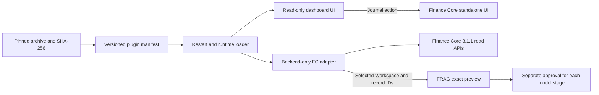

# FRAG-harness v1.4.0

FRAG-harness is a local application for governed evidence retrieval and two model API stages. It starts with no Finance Core installation, account, token, or database. The Context LLM compresses approved evidence; the Inference LLM produces a cited answer. Selection, redaction, token budgeting, approval, output validation, and citation checks are deterministic host code.

## What runs in the core

The React interface offers Harness, RAG Lab, Runs, and Plugins. The FastAPI backend owns local source parsing, exact outbound previews, single-use approval tokens for each model stage, the two model routes, citation validation, durable run history and human review, and a rebuildable SQLite FTS5 index for a bundled synthetic RAG dataset. Fake model providers work offline. Real model API credentials live only in `backend/.env`.

Both stages execute the server-owned `PreparedCall` that was previewed. It binds the complete request JSON, destination, transport, model, output schema, timeout, source revisions, selected locators, checklist and host policy versions. Revalidation rejects changed bindings; execution does not rebuild a request from evidence. Source hashing and parsing use one byte snapshot, and RAG hits, parent text and index revision share a database read snapshot. Input estimates include instructions and schemas; each stage and the cumulative run have budget checks.

The host exposes executable CLI, tool and loop registrations through `GET /api/harness/capabilities`. The fixed runner is used by both workflows. `frag.host` operates the same running FastAPI host over loopback HTTP; `kb.search` searches explicitly selected evidence and `kb.read` starts a fixed CLI process to read the selected redacted snapshot. Tools cannot expand file, locator, revision or Workspace scope. A Research runner and reviewed memory remain pending. Blocking checklist items require a reviewed `met` status before approval is available. See [runtime contracts](docs/runtime-contracts.md), [host CLI](docs/host-cli.md) and [KB tools](docs/kb-tools.md).

Runs stores explicitly selected, redacted snapshots and request specifications in an independent, Git-ignored `.local-runtime/runtime.sqlite3`. Use the session picker to group work. Editing input creates a linked new run; editing output creates a separate human revision while retaining the model original. The Runs page records acceptance, rejection and pause, and exports the same structured report as JSON or Markdown. A new revision requires its own review.

Recovery requires explicit reselection matching the saved sources, scope, revisions and request configuration, then a fresh preview and approval. A validated Context checkpoint resumes at Inference. A durably saved response can finish deterministic validation after restart. An interrupted dispatch without a committed response becomes `outcome_unknown` and cannot resume in the same run. It is never resent automatically. See [sessions and recovery](docs/runtime-sessions.md) for state, privacy and endpoint details.

Offline evaluation uses versioned synthetic Gold and the production retrieval, fixed model-stage validators, selected-read policy and tool carriers. It separates host enforcement, scripted model artifacts, missing checks and scorer failures. Literal fact checks do not establish semantic support; human review remains undetermined and Research trajectory is not run. See [offline evaluation](docs/offline-evaluation.md).

## Architecture review diagrams

These static SVG exports summarize the current host code. Each has a linked interactive HTML view and an editable Archify JSON specification under `docs/architecture/`. They are review documentation, not runtime telemetry or orchestration.

### Harness

The Harness path assembles only explicitly selected local excerpts or optional, bounded Finance Core records. The host controls redaction, exact outbound previews, approvals, and validation around the two model APIs. [Explore the Harness data flow](docs/architecture/harness/dataflow.html).


Each stage requires a separate exact-input preview and a single-use approval. The host re-reads evidence and checks the fingerprint before a call; invalid approval stops that stage. [Explore the Harness approval lifecycle](docs/architecture/harness/lifecycle.html).


### RAG Lab

RAG Lab has a Build path and a query path. Explicit Build parses headings and title paths from the bundled synthetic Markdown file, recursively splits each section into overlapping small chunks, and stores child-to-parent relationships in a separate SQLite FTS5 index. Source or index-strategy changes require an explicit rebuild. A query ranks small chunks by retrieval `chunkId`; Preview deduplicates their parent sections and shows bounded parent context with a marked hit window and a distinct Context `evidenceId`. Search and Preview make no model call. [Explore the RAG index and retrieval flow](docs/architecture/rag-lab/dataflow.html).


After retrieval, the optional answer path needs a ready index and retrieved evidence before Context Run. Context and Inference each require an exact input preview and independent one-time approval. The host checks compressed Context `evidenceId` values after the Context call and answer `evidenceIds` citations after the Inference call, before human review. [Explore the RAG query and approval lifecycle](docs/architecture/rag-lab/lifecycle.html).


Preview never calls a model. The first Run executes only the Context stage and returns validated compression plus the exact Inference instructions and input JSON for a second approval. Inference Run executes the second stage after approval. Tokens expire after ten minutes, are consumed once, and bind the displayed input to its source or index revision. Changed inputs and reused tokens are rejected. Provider credentials stay in the backend.

## Start locally

Requires Node.js, npm, Python 3.12, and `uv`. From the repository root:

```powershell
npm install
uv sync --project backend --cache-dir .tmp/uv-cache
npm run dev
```

Open `http://localhost:5173`; the backend listens on `http://127.0.0.1:8787`. To configure either model, copy `backend/.env.example` to the Git ignored `backend/.env` and set provider, model, and backend-only credentials. `fake` is the default for both stages. Put supported `.md`, `.txt`, `.html`, `.pdf`, `.docx`, `.csv`, or `.xlsx` files under `local-sources/`; the folder is ignored except for instructions and placeholders. Files are never automatically indexed by the product.

The RAG Lab source is `shared/demo/rag/synthetic-risk-review.md`. English words and Chinese bigrams are indexed as keyword terms; there is no embedding or vector retrieval. KB notes are not a product source.

Local caches, browser review profiles, and disposable test evidence under `.tmp/` have different retention rules. See the [temporary workspace guide](docs/tmp-workspace.md) before moving or cleaning them.

## Optional Finance Core plugin

The core has no Finance Core routes or navigation while the plugin is absent or disabled. A trusted plugin archive contains exactly `manifest.json`, `adapter.py`, and `ui.js`. Its manifest declares `id: finance-core`, `protocolVersion: 1`, its semantic version, `minHostVersion: 1.0.0`, `fcApiVersion: 3.1.1`, and SHA-256 hashes for both code files. The installer checks the pinned archive hash, bounded entry sizes, file hashes, and compatibility before activation. Installed code executes in the local backend, so install only a trusted release. Finance Core distributes the optional archive separately; synthetic tests verify the host without FC credentials or a live Vault.

```powershell
# Official pinned GitHub release asset
powershell -NoProfile -ExecutionPolicy Bypass -File ./scripts/install-plugin.ps1 -ReleaseUrl '<github-release-asset-url>' -ExpectedSha256 '<64-character-sha256>'

# Or a separately obtained local archive
powershell -NoProfile -ExecutionPolicy Bypass -File ./scripts/install-plugin.ps1 -ArchivePath './finance-core-plugin.zip' -ExpectedSha256 '<64-character-sha256>'

# Disable without removing installed files
powershell -NoProfile -ExecutionPolicy Bypass -File ./scripts/install-plugin.ps1 -Disable

# Re-enable an installed version
powershell -NoProfile -ExecutionPolicy Bypass -File ./scripts/install-plugin.ps1 -Enable
```

Restart FRAG after install or disable. The plugin supplies a read-only dashboard and scoped Workspace record choices. Journal and all other mutations open Finance Core's own UI. A selected Workspace and at most ten record IDs enter the host preview through a read-only FC `/api/v3` adapter; the host never opens FC SQLite or indexes the whole finance database. The FC token stays backend-only. The adapter checks FC 3.1.1 health and version before bounded reads. Installing the archive does not configure FC or establish live integration; that requires a separately reviewed local FC setup.

The local Plugins page also accepts a trusted ZIP and its published SHA-256 for installation, and offers Enable, Disable, and Uninstall controls when a package is on disk. These controls run the same pinned PowerShell installer. Uninstall removes all locally installed Finance Core plugin versions and the activation pointer, after confirming every version contains only the three expected files. A successful management action hides plugin routes for the rest of that server session. Restart FRAG to load or unload the package. The private Sites design preview cannot perform these local operations.



Plugin adapter contract: `create_router()` returns only `GET` or `HEAD` routes under `/api/plugins/finance-core/`. It should expose `GET /api/plugins/finance-core/scopes` for Workspace and bounded record choices and `GET /api/plugins/finance-core/dashboard` for read-only display. `read_evidence(workspace_id, record_ids)` returns one item per selected ID with `recordId`, `label`, `text`, and `revision`. The host re-reads those records on Run and binds their revisions to approval. The UI bundle exports `mount(element, { apiBase })` and returns an optional cleanup function. The archive must not contain secrets.

## Checks and boundaries

```powershell
npm test
npm run typecheck
npm run build
$runId = [guid]::NewGuid().ToString('N')
$env:PYTEST_ADDOPTS="--basetemp=.tmp/pytest-frag-$runId -p no:cacheprovider"
npm run test:python
```

Tests use synthetic sources and temporary indexes. Backend-only keys and optional FC tokens must never enter browser assets, prompts, logs, tracked files, or error responses. Model answers require human review. FRAG does not connect to trading, banking, payment, or live-market APIs. The [plugin handoff](docs/finance-core-plugin-handoff.md) defines the optional FC integration boundary.

LangGraph runs embedded in FastAPI for Preview, Context Run, and Inference Run orchestration in Harness and RAG Lab. Host code still owns evidence selection, budgets, approval tokens, provider calls, and validation. The graphs have no checkpointer, external Agent Server, or LangSmith tracing. [Future Agent Server assessment](docs/horizon/horizon-1.md). Archify is an optional project-local Codex skill under the Git-ignored `.agents/skills/archify` directory for development review, not an application dependency.

Thanks to [Archify](https://github.com/tt-a1i/archify) for the diagram tooling.
