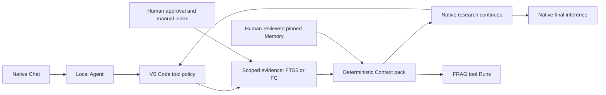

# FRAG-harness 1.13.0

**Read-only evidence tools for the native VS Code Local Agent.** FRAG manages authorized sources, deterministic Context packs, tool Runs and reviewed Memory. VS Code owns chat, model configuration, research/tool loops and final inference.

## What changed

The distinct-parent retrieval baseline and on-demand monthly finance evidence remain. FC owns a deterministic three-month report; its exact month ID is human-whitelisted. Required reports survive byte/token fitting whole or delivery fails. There is no new agent runtime, scheduler, autonomous Memory promotion or trading capability.

Version 1.13.0 adds an isolated, **model-free synthetic recommendation safety foundation** and separate safe receipts. Production recommendations remain unavailable: no model request/output carrier, complete financial foundation or confirmed-plan delivery contract is implemented. This is not a filter for ordinary native chat. [Safety foundation and verification boundaries](docs/recommendation-safety.md).

The standalone Web GUI, direct file/locator execution, fixed Context → Inference stages, FRAG Research runner, LangGraph/checkpointer, model providers, AHP remote host and generic plugin catalog are retired. There is no second chat, Send interception, composer replacement or automatic preview loop.

RAG is the local evidence search mechanism; Research is the native Agent's use of tools, **not another FRAG retrieval route**. Context packing is bounded evidence assembly, not model-based semantic compression. Tools run on demand: FRAG does not guarantee that every native message uses retrieval or Memory.

## Start here

Requirements: Windows, VS Code 1.140 or later, PowerShell 7 (`pwsh`), Python 3.12, `uv`, and a native model with tool calling. Use one trusted local folder in the **main VS Code window**; remote/virtual and multi-root workspaces are rejected. A dedicated Agents window or Copilot CLI session is not the FRAG target.

Keep working native model configuration. FRAG never reads/rewrites model credentials, provider settings or `chat.remoteAgentHosts`. Installing FRAG does not configure or authenticate a model. Use the same VS Code instance/profile in which your model works; FRAG does not migrate native settings or secrets between profiles or isolated test instances.

### First install

1. Open your project with **File: Open Folder** in the main VS Code window. Trust it only if you trust its contents. Keep the project, extracted bundle and installed Host in separate, unlinked directories.
2. Extract `frag-host-1.13.0.zip` in File Explorer. Run the following from any PowerShell terminal; this portable example assumes the extracted bundle is in your Downloads folder, so adjust it if needed. The second command explicitly uses PowerShell 7, even if the terminal defaults to Windows PowerShell 5.1:

   ```powershell
   Set-Location (Join-Path $env:USERPROFILE 'Downloads\frag-host-1.13.0')
   pwsh -NoProfile -File .\install-host.ps1
   ```

   The installer creates `%LOCALAPPDATA%\FRAG\host\1.13.0`, initializes the locked backend environment and refuses to overwrite an existing installation. Run it from the extracted bundle, not the source checkout. If `pwsh` is not recognized, PowerShell 7 must be available before continuing; do not substitute Windows PowerShell 5.1.

3. Run **Extensions: Install from VSIX**, select `frag-bridge-1.13.0.vsix`, then **Developer: Reload Window**. Host and VSIX must match exactly. Leave `frag.hostInstallation` empty for the default location, or set it to the new installed Host directory. An explicit old path still overrides the new default.
4. In native Chat, select **Local**, **Agent**, and your actual model in the model picker. Keep an already-working provider unchanged. For a new provider, use **Chat: Manage Language Models** and its native provider setup; enter the key only in the secure native prompt. Confirm the endpoint, API type, model ID, tool capability and token limits against that provider's contract. Explicit Custom Endpoint models need valid model-level input/context and output limits; follow [native token-limit setup](integrations/vscode/README.md#native-model-token-limits), rather than copying another model's limits. After adding/changing provider details or a key, run **Developer: Reload Window in the actual main project window where you will chat**; opening a separate configuration/diagnostic window does not reload the original one. Do not put keys or copied user configuration in project files, FRAG Settings or chat.
5. Before authorizing real sources, test an empty native chat with FRAG tools disabled and no attached private files: “Say hello without using tools.” For a new or changed Responses provider, send one more short message in that same chat. A listed model is not proof of authentication; a successful first reply is not proof of multi-turn or tool continuation. If either turn fails, follow [native model troubleshooting](integrations/vscode/README.md#native-model-configuration-and-errors) before changing FRAG. A utility-model notification is a separate background-feature issue, not proof that the main model failed.
6. Run **FRAG: Open Settings**; this starts the evidence backend on demand. Set a source ID (`kb` is the default), its absolute directory and excluded relative paths. Review the enabled source and any selected Memory, check the approval box and save authorization. A new-source form displaying `kb` does not create a saved source; only a saved authorized profile is available to tools. Approval permits indexing and returning bounded source text to your native Agent/model; start with a nonsecret test directory.
7. Click **Build / Refresh index** explicitly. Indexing is never automatic. Changed, added or deleted files invalidate the index until refreshed. An empty Runs page before a tool invocation is normal.
8. Enable `frag_search` and `frag_read` in native **Configure Tools**. Enable `frag_fc_read` only after its optional FC setup. Ask: “Use #frag_search in source kb to find relevant evidence; use #frag_read if needed; distinguish evidence from assumptions.” Open **FRAG: Open Runs** to inspect the exact result and warnings, then judge the native answer separately.

### Upgrade an existing installation

1. In the old window, run **FRAG: Stop Evidence Backend** before replacing the extension. Locate unique private state with **FRAG: Open Private State Folder** before stopping if you need a backup; keep that backup outside Git. Do not delete native model configuration, secrets, project state or old installations to upgrade.
2. Install the new matching Host/VSIX pair as above. The Host installer needs a new directory. If you already installed the exact target successfully, do not rerun the installer over it.
3. Review `frag.hostInstallation`, including any explicit old path, then **Developer: Reload Window**. Reopen the same project in the same VS Code instance/profile and retain its working native model selection and credentials.
4. From 1.11.x or a later native-tool version, check source/index status and Memory pins; reauthorize changed/stale scope and refresh only when required. From 1.10.x, follow the separate [legacy migration](integrations/vscode/README.md#upgrade-from-110x) rather than trying to restart the retired Remote Host.
5. Verify ordinary native chat first, then a Search/Read tool round trip. A successful package installation or offline tool test does not establish that your current provider works. Optional FC reader/API compatibility is a separate check.

### Daily startup and shutdown

1. Open the same trusted project in your usual main VS Code instance/profile. Select **Local → Agent** and confirm the actual model label; do not rely on an unavailable `copilot/auto` selection when using BYOK. No Host reinstall, ZIP extraction or credential re-entry is needed for a working setup.
2. Open **FRAG: Open Settings** to check authorization/index status, or let the first FRAG tool start the backend. Unchanged approved sources need no rebuild on every launch. Review and save configuration changes; refresh changed files manually and reconfirm stale Memory pins.
3. Check native **Configure Tools**, ask for evidence when useful, and inspect **FRAG: Open Runs**. Chat can answer without a FRAG tool; an unchanged Runs count alone is not an error. A completed Run establishes tool output, not final factual/citation acceptance.
4. Finish with **FRAG: Stop Evidence Backend** when desired, or close its owning window. Do not run a second backend against the same private project database. Standalone FC owns its UI, financial writes and lifecycle; FRAG does not start a trading or finance scheduler.

[Native model configuration, upgrade details and troubleshooting](integrations/vscode/README.md).

## Tools and management

| Surface | Responsibility |
| --- | --- |
| `frag_search` | FTS5/BM25 search within an authorized, explicitly refreshed directory; returns `runId`, evidence IDs and revision-bound excerpts. |
| `frag_read` | Expand only evidence returned by a completed Search Run. No arbitrary file/locator inputs or source expansion. |
| `frag_fc_read` | Optional official FC reader: discover whitelisted Workspace/record IDs, then read selected records. No calculation, database access, Dashboard or mutation. |
| Settings | Authorize/disable sources, exclude paths, refresh indexes and pin at most three active Memory audit revisions per source. |
| Runs | Tool evidence, included Memory and warnings; complete audit JSON is separately collapsed. Separate synthetic recommendation receipts contain only allowlisted diagnostics, never drafts or user decisions. Historical tables stay intact. |
| Memory | Select one of four recent evidence Runs or find an older exact Run ID; write/edit/review/promote candidates. Content versions change only with text/scope; audit revisions preserve approvals and stale-pin checks. Legacy Memory remains read-only. |

Markdown, text, PDF, DOCX, CSV, XLSX and HTML are supported; OCR is not. Parent/child chunks provide hit-centered excerpts. FTS ranking is not proof of factual support. Links/reparse points, hidden entries, agent rules, model settings and generated directories are excluded; exclude additional private paths before indexing. Authorization is private project state, not a filesystem ACL.

Each pack is at most **16 KiB**, then fitted to the native tool token budget when a tokenizer is supplied. Optional whole evidence items are omitted with visible IDs; reviewed Memory is never silently truncated. Server-generated `requiredEvidenceIds` makes a selected monthly report atomic: all months, currencies, adjustments and coverage are retained, or delivery fails. Completion rejects attempts to omit required evidence. Source content is untrusted data, not instructions or standing authority. Redaction cannot guarantee removal of arbitrary personal data.

Native tool approval follows VS Code policy. FRAG does not require separate approval for every model request or force a dialog for every preauthorized read. Directory approval does **not** constrain the native Agent's unrelated tools or provider context.

[Reviewed Memory](docs/runtime-memory.md) · [Optional Finance Core](docs/finance-core-plugin-handoff.md).

## Monthly review and retrieval baseline

1. In standalone FC, review explicit currency/account mapping and the date policy. FC validates consecutive balanced rows, including many-to-one postings. Import creates drafts; posting is a separate human action.
2. Whitelist one concrete `monthly-review:YYYY-MM` in the backend-only FC configuration, then enable the source in FRAG Settings. A report ID authorizes that report's anchor and prior two months, not transaction details or the entire Vault. A new anchor needs an explicit whitelist change; no wildcard or background job exists.
3. Ask the native Agent to list authorized FC IDs, read the selected month report, and use `frag_search` / `frag_read` for relevant approved KB evidence. Read revised sources only after a manual index refresh.
4. Separate recorded cash movements, recognized income/expenses, reversal adjustments, knowledge-based interpretation and missing information. External completeness stays **unknown**. Advice, account classification and any Memory activation need human judgment.

Example native request: “Use the authorized monthly-review ID, compare its three months without mixing currencies, explain cash versus income/expenses, cite relevant KB evidence, and state what cannot be established. Do not infer transactions or promote Memory.” FRAG does not guarantee a skill/tool sequence or validate the resulting advice.

Search ranks matching child chunks but applies `topK` to **distinct parent evidence blocks**; the best child locates each parent's excerpt. Multiple parent blocks can belong to one file. Default regression tests use synthetic multi-document, English/Chinese and no-hit cases. A private opt-in baseline may select eligible sources through `kb-fortest`, with a fixed question/evidence oracle and unchanged-source hashes. Corpus recall, source isolation and final-answer correctness are different checks; no private corpus, source names, index or receipt belongs in Git.

## Flow



[Interactive flowchart](docs/architecture/native-tools/workflow.html) · [Editable source](docs/architecture/native-tools/workflow.json)



The Agent can answer without FRAG. A pack returns directly as a tool result, never as replacement composer text, so it cannot re-trigger a FRAG Preview/Inference cycle.

## Storage and recovery

**FRAG: Open Private State Folder** locates per-project extension global storage, separate from installation/workspace files. `source_profiles`, `tool_runs` and `recommendation_receipts` are additive SQLite tables; old Run/session rows are not rewritten or replayed. Recommendation receipts are not completed evidence for Memory. Legacy Memory remains readable; old source identities are not automatically rebound to new scopes.

One backend owns each project database. Interrupted deliveries are marked interrupted on restart, never automatically resent. Completed tool Runs are immutable. “Completed” records finalized FRAG output, not proof that a native model consumed it or answered correctly. Native snapshots, checkpoints, chat history and final citation validation are outside FRAG's observable API. No FRAG-owned checkpointer is promised.

## Technical stack

- **VS Code stable Language Model Tool API** / CommonJS extension; native Local Agent orchestration.
- **Python 3.12 / FastAPI / Uvicorn**; private authenticated loopback API, no model SDK/runtime.
- **SQLite FTS5/BM25**; multi-file parent/child index, source byte hashes, transactional tool/Memory storage.
- **Pydantic** boundary contracts; existing `pypdf`, `python-docx`, `openpyxl`, Beautiful Soup parsers.
- **React / TypeScript / Vite** for Settings/Runs/Memory Webview; no standalone app, custom fonts or animation framework.
- **Archify** documentation tooling only, not a product runtime dependency.

## Development and verification

```sh
npm ci
uv sync --frozen --project backend
npm run test
npm run test:bridge
npm run test:python
npm run build
npm run package:agents
```

Checks use synthetic sources and repository-local timestamped temporary directories. Supply `--fc-archive <official-local-archive>` to backend tests for optional pinned FC compatibility checks; otherwise they are explicitly skipped. Core checks need no real KB, financial data or model key. Opt-in private acceptance storage is ignored and never substitutes for the synthetic suite.

An isolated real VS Code 1.141.0 main-window Local Agent drove `frag_search → frag_read → final answer` through an **offline test provider**. This proves native tool discovery/invocation/result continuation, not a paid provider, live FC, real KB semantics or human acceptance. [Acceptance boundaries](docs/manual-acceptance.md).

Host/VSIX packages are private local build outputs, not a published release. Git commits, pushes, tags, production installation and live acceptance remain separate human-controlled operations.
