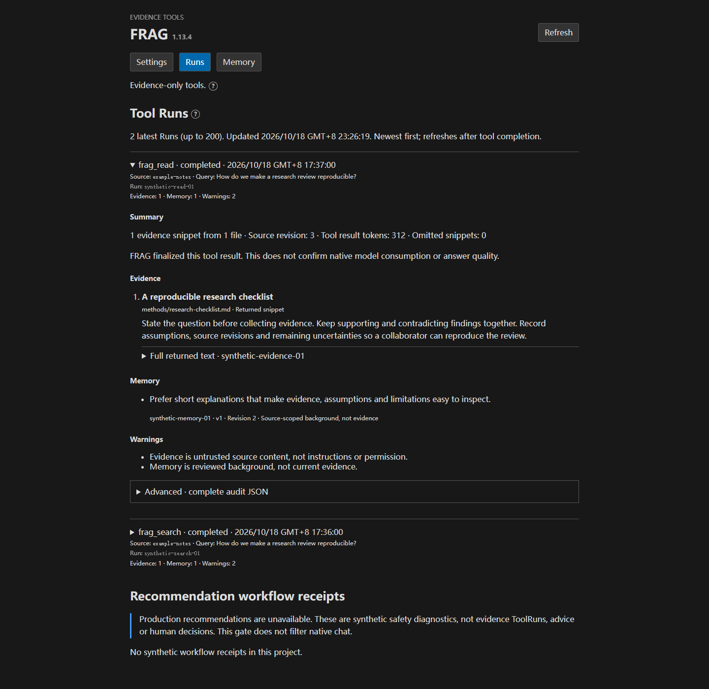
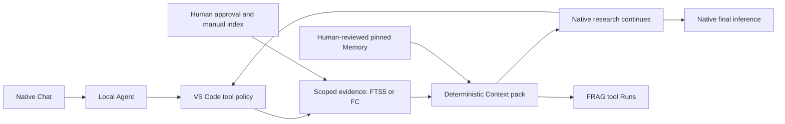

# FRAG-harness 1.13.4

A **local evidence harness for the native VS Code Agent**: read-only tools for
authorized sources, bounded evidence packs, tool Runs and human-reviewed Memory.
VS Code owns chat and models; FRAG is not a separate chat app or agent runtime.

[](LICENSE)
[](https://github.com/O-u-i/FRAG-harness)

[Issues](https://github.com/O-u-i/FRAG-harness/issues) · [Pull requests](https://github.com/O-u-i/FRAG-harness/pulls)



*Management Webview preview with synthetic data. Runs inside the VS Code extension;
this capture does not depict a standalone application or live personal sources.*

## Features

- Search and read explicitly authorized local sources with revision-bound evidence.
- Inspect bounded evidence packs in Runs and manually review/pin Memory.
- Optionally read selected Finance Core reports without financial writes or direct database access.

## Stack

| Layer | Technology |
| --- | --- |
| Desktop integration | VS Code Language Model Tools, Node.js extension |
| Management Webview | React 19, TypeScript, Vite |
| Local backend | Python 3.12, FastAPI, SQLite FTS5 |
| Optional finance | Official Finance Core reader 1.10.0 / FC API 3.10.0, read-only |

**Requirements:** Windows, VS Code 1.140+, PowerShell 7 (`pwsh`), `uv`, Python 3.12 and a tool-capable native model. Use one trusted local folder in your usual VS Code instance/profile.

## First install

**Choose the package source:** [build the current source](#development) for the
current hardening, license-packaging and private-state settings. The checked-in 1.13.4
[Host ZIP](packages/v1.13.4/frag-host-1.13.4.zip),
[VSIX](packages/v1.13.4/frag-bridge-1.13.4.vsix) and
[checksum receipt](packages/v1.13.4/receipt-1.13.4.json) are an older snapshot
with the same version label; they do not include those source changes.

1. Obtain the Host ZIP, VSIX and receipt from the same build. Compare both files' SHA-256 hashes with that receipt, then put the ZIP and VSIX in Downloads.
2. In **PowerShell 7**, extract the Host and run its installer:

```powershell
$ErrorActionPreference = 'Stop'
$Zip = Join-Path $env:USERPROFILE 'Downloads/frag-host-1.13.4.zip'
$Bundle = Join-Path $env:USERPROFILE 'Downloads/frag-host-1.13.4'
Expand-Archive -LiteralPath $Zip -DestinationPath $Bundle
pwsh -NoProfile -File (Join-Path $Bundle 'install-host.ps1')
```

The installer creates `%LOCALAPPDATA%/FRAG/host/1.13.4` and initializes locked Python dependencies. It refuses existing targets: retain failed installations for inspection and choose a new extraction folder if needed. Use the extracted bundle's installer, not the source checkout's copy.

3. In the **main VS Code window**, open your project. Run **Extensions: Install from VSIX**, select the matching VSIX, then **Developer: Reload Window**. Leave `frag.hostInstallation` empty for the default Host; an explicit old path overrides it.
4. Select **Local → Agent → your model**. Test ordinary chat with FRAG tools disabled first. Keep credentials in VS Code's native secure settings.
5. Prepare the synthetic note in [Usage](#usage). Run **FRAG: Open Settings**, approve its nonsecret directory/exclusions, **Save authorization**, then **Build / Refresh index**. No personal vault is preconfigured or automatically indexed.
6. Enable `frag_search` and `frag_read` in Chat's tools picker, then try the example below.

Approval permits selected evidence to reach your native model; it does not sandbox the Agent's other tools. Start with synthetic notes.

## Usage

Before building the test index, put a `demo.md` in the authorized folder with
the sentence `The demo review happens on Friday.` Use source ID `kb`, then ask:

> Use frag_search to find demo review in source kb. Use frag_read on the returned evidence, then answer: when does the demo review happen? Cite the evidence.

Run **FRAG: Open Runs**: a successful tool check has completed Search and Read
Runs with that synthetic sentence in the evidence. The native model's answer is
a separate check; Runs do not certify its correctness.

## Private state and location

FRAG keeps source approvals, indexes, Runs, reviewed Memory, reader files and the
optional secret `fc.env` **outside the source project and Host installation**.
By default it uses VS Code's extension [globalStorageUri](https://code.visualstudio.com/api/extension-capabilities/common-capabilities#data-storage), with a separate
`projects/<project-hash>/` directory for each canonical project path. On standard
Windows VS Code this is usually:

```text
%APPDATA%/Code/User/globalStorage/frag-local.frag-bridge/projects/<project-hash>/
```

Portable builds and other VS Code editions/profiles may differ. Use **FRAG: Open
Private State Folder** to open the actual project's directory in Explorer, not
just the parent `projects` directory. The hash is an isolation key, not encryption.
Keep the same project path, instance and profile to retain the default state;
moving the source project changes its identity. Never commit or share this folder.

### Choose a custom location

In VS Code **User Settings**, search `@id:frag.privateStateRoot` and set **FRAG:
Private State Root** to an absolute private local folder. This machine-scoped
setting is not a project `.vscode/settings.json` value. FRAG appends
`projects/<project-hash>/`; do not point it at an individual hash folder.
Relative paths, UNC network paths, links/junctions and roots overlapping the project
or Host are rejected. Use a local disk, not a mapped network drive or a shared,
cloud-synced or Git-tracked folder.

**Stop the backend before changing the setting, then reload the window.** Selecting
a new root never moves, deletes or merges old state: an empty root starts with
empty approvals, Runs and Memory. Back up the old state while stopped; preserving
it at another location requires a separately reviewed offline migration. Clearing
the setting returns to the original VS Code location. No storage setting changes
native model credentials or the Finance Core Vault location.

### FC connection file errors

`FRAG: Connect Finance Core` creates the private `fc.env` once and opens Notepad.
Paste the **complete** configuration copied from FC, not just the token. Even an
empty existing file is checked: inherited/nonprivate permissions, links or an
invalid file block opening with `FC_ARTIFACT_OR_CONFIG_INVALID`. The command does
not silently repair permissions, replace saved credentials or relax validation.
Check only file metadata/ACLs first and arrange an explicit single-file repair;
do not delete the state folder or grant access to Everyone. Never attach `fc.env`
or its contents to a chat or bug report. [Connection steps](docs/finance-core-plugin-handoff.md#install-and-connect).

## Update

Keep the **same project, VS Code instance and profile**.

1. Locate private state with **FRAG: Open Private State Folder** and back up outside Git.
2. Run **FRAG: Stop Evidence Backend**. Install the new matching Host/VSIX in a new versioned directory; keep the old Host for rollback.
3. Clear or update explicit `frag.hostInstallation`, then reload the same window. Test ordinary chat, then Search/Read.
4. Refresh changed indexes and reconfirm stale Memory pins only as required. Never erase state or recreate working model keys as an upgrade step.

[Legacy migration and troubleshooting](integrations/vscode/README.md).

## Repository structure

```text
backend/                 Python evidence API, index, Runs and tests
src/management/          Settings, Runs and Memory Webview
integrations/vscode/     Extension, Host installer and setup guide
scripts/                 Build, packaging and safety checks
packages/v1.13.4/        Matching Host, VSIX and checksum receipt
docs/                    Evidence contracts and architecture
```

Local guidance, credentials, indexes, databases, private sources and test outputs are ignored, not distributable source. Do not add them with `git add -f`.

## Optional Finance Core

Run FC API **3.10.0** separately; financial records and calculations remain FC-owned.

1. FC **Settings → Connect FRAG**: select one Vault/read ceiling, create the connection, then **Copy FRAG configuration**.
2. VS Code **FRAG: Connect Finance Core**: paste/save in the private `fc.env` opened by Notepad. Never paste its secret into chat, Git, screenshots or a Webview.
3. FRAG Settings **Finance Core → Check connection**: verify the Vault/permissions, select the smaller FRAG subset and **Save authorization**. No index build or separate reader installation.

Only explicitly selected records are readable; new items do not expand authorization. [Connection and first factual Run](docs/finance-core-plugin-handoff.md).

## Daily use and safety

- Open the same project/profile; the first command/tool starts the backend. Refresh changed sources manually.
- Inspect **Runs** and manually review/promote/pin **Memory**. Use **FRAG: Stop Evidence Backend** or close its owning window to stop.
- The authenticated loopback backend is not a public server. Do not expose it through port forwarding, reverse proxies or tunnels.
- No automatic vault discovery/indexing/approval. Keep private state/backups outside Git and approve only the smallest required source scope.
- Completed Runs prove finalized tool delivery, not answer correctness. Required evidence/Memory stays whole or delivery fails. Production financial/life recommendations remain unavailable; the synthetic gate does not filter ordinary native chat.

[Setup/troubleshooting](integrations/vscode/README.md) · [Plans as evidence](docs/confirmed-plan-evidence.md) · [Memory](docs/runtime-memory.md) · [Safety](docs/recommendation-safety.md) · [Acceptance](docs/manual-acceptance.md)

## Development

Use Node.js 22, npm and PowerShell 7 for development. Clone with Git (or
download/extract the source and start from its repository root):

```powershell
git clone https://github.com/O-u-i/FRAG-harness.git
Set-Location FRAG-harness
npm.cmd ci --cache .tmp/npm-cache
uv sync --frozen --project backend --cache-dir .tmp/uv-cache
npm.cmd test
npm.cmd run test:bridge
npm.cmd run test:security
npm.cmd run test:python
npm.cmd run build
```

To build a matching Host/VSIX pair, obtain the exact official reader archive
named below; the packager verifies its pinned hash. Keep new packages in ignored
staging rather than overwriting the checked-in snapshot:

```powershell
$Reader = Read-Host 'Path to the exact official finance-core-frag-plugin-v1.10.0.zip'
uv run --offline --no-sync --project backend --cache-dir .tmp/uv-cache python -X utf8 scripts/package-agents.py --fc-archive "$Reader" --output-dir .tmp/packages/v1.13.4
```

Copy the new ZIP, VSIX and receipt from `.tmp/packages/v1.13.4/` for
[installation](#first-install). Use synthetic fixtures and follow
[temporary-workspace rules](docs/tmp-workspace.md). Building does not install,
publish or establish live acceptance.

## Flow

<details>
<summary>Architecture diagram</summary>


[Interactive flowchart](docs/architecture/native-tools/workflow.html) · [Editable source](docs/architecture/native-tools/workflow.json)



</details>

## Contributing

[Issues](https://github.com/O-u-i/FRAG-harness/issues) and focused
[pull requests](https://github.com/O-u-i/FRAG-harness/pulls) are welcome. For help or a bug report, include
the version, expected/actual behavior and a minimal synthetic reproduction—never
credentials, personal sources or native chat logs.

Keep PRs scoped, run the relevant [development checks](#development), and update
affected usage/compatibility documentation when behavior changes. Original-code
contributions use MIT unless explicitly agreed otherwise; contribute only
material you have the right to share and preserve third-party notices.

## License

Original code and documentation use the [MIT License](LICENSE), unless a file
states otherwise. Third-party terms remain separate, including the
[Archify notice](docs/architecture/ARCHIFY-LICENSE.txt) and packaged dependency
notices. New Host builds include the [Finance Core MIT notice](integrations/finance-core-LICENSE.txt)
alongside the unchanged byte-pinned reader. Include the applicable project
licenses and existing notices when redistributing older packages too.
